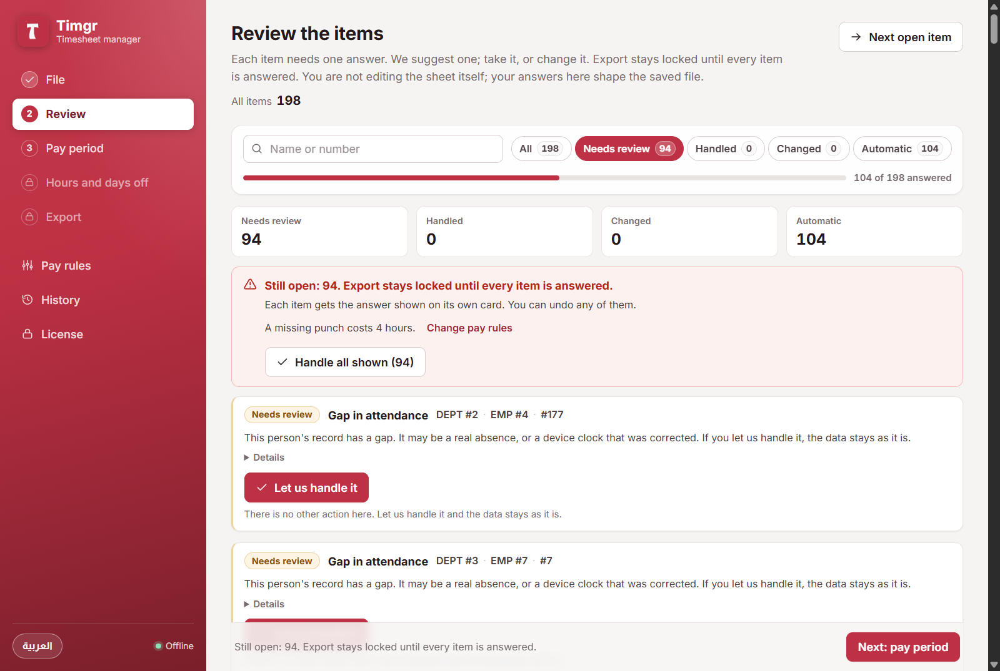
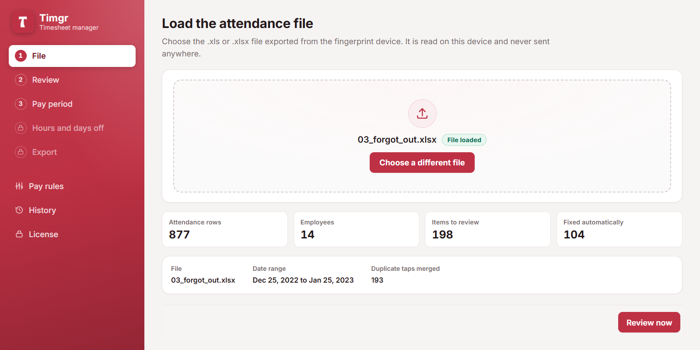
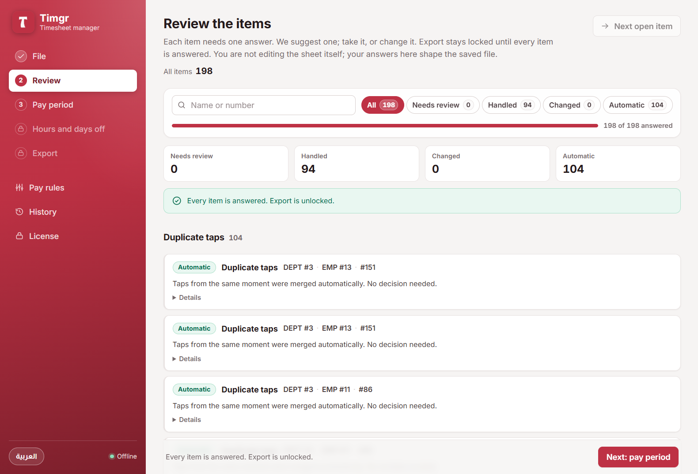
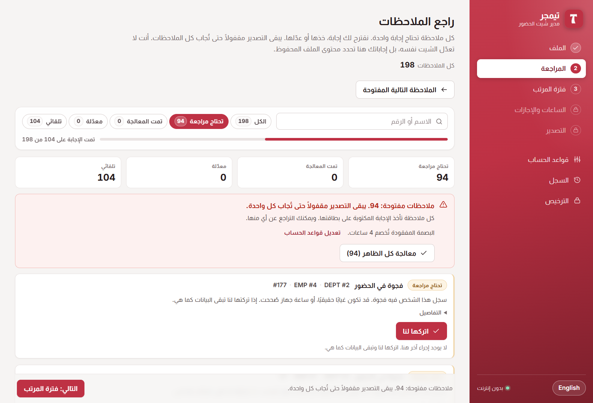

<div align="center">


# Timgr

**Turn a fingerprint attendance export into a payroll-ready timesheet.**

Runs on your own Windows PC. No account, no server, no telemetry.

   

**[Download](#download)** &nbsp;·&nbsp; [Screenshots](#screenshots) &nbsp;·&nbsp; [What it catches](#what-it-catches) &nbsp;·&nbsp; [Licensing](#licensing) &nbsp;·&nbsp; [Release notes](../../releases/latest)



</div>

## Why

A month of attendance comes out of the device full of noise: taps a second apart, people who forgot to clock out, one clock that jumped 45 days. Fixing that by hand in Excel takes hours, and the mistakes reach payroll.

Timgr merges what can be merged on its own, puts the rest in front of you one item at a time with a suggested answer, and writes the workbook payroll already expects.

## What it does

| Step | What happens |
| --- | --- |
| **1. File** | Open the `.xls` or `.xlsx` export from the fingerprint device. It is read on this PC and never sent anywhere. |
| **2. Review** | Duplicate taps are merged, punches are paired into shifts, and anything odd waits for your answer. Export stays locked until every item has one. |
| **3. Pay period** | The days this export pays for, the working hours, the weekly day off, the saved holidays, and the pay rules. |
| **4. Export** | A preview of the finished sheet, then a saved `.xlsx` in the layout payroll already uses. |

## What it catches

Each of these is a decision you can see and change, not a silent guess:

| What it finds | What you do about it |
| --- | --- |
| **Duplicate taps** | Two taps from the same moment. Merged on their own, and listed so you can see it happened. |
| **Clock-in with no clock-out** | Apply the missing-punch penalty, or type the real clock-out time. |
| **Clock-out with no clock-in** | The same, from the other side. |
| **Accidental tap** | Clock-in and clock-out only seconds apart, usually someone walking past the device. Remove the shift, or keep it. |
| **Gap in attendance** | A break in that person's days: a real absence, or a clock that was corrected. Keep the data as it is. |
| **Dates far from the rest** | A jump of 45 days or more, usually a device glitch. Keep the punches, or exclude the days you choose. |
| **Two departments** | One employee number under more than one department. Pick the department payroll uses. |
| **Different name spellings** | One employee number, two spellings. Keep both, or pick the right one. |

A status value the app does not recognise stops the file and names the values. It is never guessed at.

## Preview before saving

The export step shows the sheet before anything is written: totals, worked shifts, incomplete rows, absences, bonus and deduction hours, and every person's rows. Punches outside the pay period are counted and shown separately, so nothing is dropped quietly. Days off are marked, and work done on them lands in the holiday column.

## Screenshots

<p align="center">
  
  <br />
  <sub>One export loaded: 877 rows, 14 employees, 193 duplicate taps merged, 104 items fixed on their own, 198 left to answer.</sub>
</p>

<p align="center">
  
  <br />
  <sub>Every item answered, so export unlocks. Nothing is saved until you look at the preview.</sub>
</p>

<p align="center">
  
  <br />
  <sub>The whole interface in Arabic, right to left. Dates, times, and employee numbers keep their own direction inside the Arabic text.</sub>
</p>

## Download

**[Timgr 1.3.0 for Windows](../../releases/latest)** is the current build: one installer, for Windows 10 and 11 on 64 bit.

| File | Size | SHA-256 |
| --- | --- | --- |
| `Timgr_1.3.0_x64-setup.exe` | 5,456,463 bytes | `AFF52823E20448064032910DF6793C433A04231F9DBF5BBF2BFAEE42302AD875` |

`SHA256SUMS.txt` is attached to the same release. Check the file before you run it:

```powershell
Get-FileHash .\Timgr_1.3.0_x64-setup.exe -Algorithm SHA256
```

The result must match the hash above.

## Install

1. Run `Timgr_1.3.0_x64-setup.exe`.
2. Windows SmartScreen shows **"Windows protected your PC"** because the installer is not code-signed yet. Choose **More info**, then **Run anyway**.
3. It installs for the current Windows user with a Start-menu shortcut. There is no admin prompt.

Needs Windows 10 (1809 or newer) or Windows 11, 64 bit, and about 200 MB of disk. Most of that is Microsoft's WebView2 runtime: Windows 11 and updated Windows 10 already have it, and the installer fetches it only when it is missing.

Installing a newer version over an older one keeps your settings, drafts, and export history.

## Licensing

Saving a workbook needs a license: one small signed file, checked on this PC and never sent anywhere.

1. Open **License** in the app. If the license is tied to this PC, copy the **Device code** shown there.
2. Send that code to whoever issues your license.
3. Import the `.timgr-license` file you get back, or paste its text. The screen then reads **This device is licensed**.

A license that fails to import never replaces the one already on the machine.

## What's new in 1.3.0

- **A signing key no longer needs a new installer.** The app carries a root key that can authorise a daily signing key, so keys can be rotated without shipping a new build.
- **Delegated licenses say so.** A license signed by a delegated key shows **ISSUED UNDER** with the root that authorised it.
- **Damage is named.** An edited delegation reads "This license is damaged or was changed"; a missing or repeated one reads "This license's signing chain is not valid".

The review screen, the pipeline, and the saved workbook are unchanged from 1.2.x. Full notes are on the [release page](../../releases/latest).

## Privacy

- No account, no sign-in, no telemetry, no crash reporting.
- The attendance file never leaves the PC, and the app makes no network requests.
- The only network use anywhere is the installer fetching WebView2 when Windows is missing it.
- Data lives in `%APPDATA%\com.timgr.desktop`: settings, drafts, export history, the installed license. Delete that folder to remove it.

## Questions

<details>
<summary><b>Does it need the internet?</b></summary>
<br />
No. The app works with the network cable out. The installer is the only thing that may reach the internet, and only to fetch WebView2 when Windows does not have it yet.
</details>

<details>
<summary><b>Does it change my export file?</b></summary>
<br />
No. The export is read and left as it is. The workbook is written as a new file, and you choose where it goes.
</details>

<details>
<summary><b>Why does Windows warn about the installer?</b></summary>
<br />
The installer is not code-signed yet, so SmartScreen treats a new file with an unknown publisher as risky. **More info**, then **Run anyway** gets past it. The SHA-256 above is how you check the file is the one published here.
</details>

<details>
<summary><b>Can I install it on another PC?</b></summary>
<br />
Yes, the same installer. A license that is tied to a device code is issued for one PC, so send the new device code and get a license for that machine.
</details>

<details>
<summary><b>What if I lose the license file?</b></summary>
<br />
Ask for it again and quote your device code. Your attendance data and settings are not affected.
</details>

<details>
<summary><b>Is my old saved sheet still there?</b></summary>
<br />
Yes. Every export is kept in **History**, with the file you saved it to.
</details>

## Uninstall

Windows **Settings > Apps > Timgr > Uninstall**, or the Start-menu uninstaller. Drafts and history in `%APPDATA%\com.timgr.desktop` are kept; delete that folder to remove them too.

## Older versions

The **v2.5.x** releases are the earlier Python version of Timgr, kept for reference. The current app is the Windows installer above and is a different program: no Python, nothing to install first.

## License

This software is proprietary. Unauthorized copying, modification, or distribution is prohibited. For licensing questions, contact the development team.

---

<sub>Last updated November 2026. Found a problem? Open an issue.</sub>
